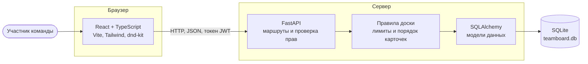

# TeamBoard - Kanban-доска для студенческой команды

[](https://github.com/gleb-khryapin/up-mdk-02.02-Ivanov-Khryaping/actions/workflows/ci.yml)


Учебная практика по МДК 02.02 «Инструментальные средства разработки программных модулей».
Тема 3: модуль управления задачами для студенческой команды.

## Команда

| Участник | Роль |
|---|---|
| Хряпин Г. С. | тимлид, тестировщик |
| Иванов В. В. | разработчик |

## Возможности

- регистрация и вход по JWT, роли тимлида и разработчика;
- доска с пятью колонками: бэклог, к выполнению, в работе, на проверке, готово;
- перетаскивание карточек мышью между колонками;
- ограничение на количество задач в колонке «В работе»;
- приоритет, оценка в часах, исполнитель и ветка Git у каждой задачи;
- разграничение прав: разработчик не может создавать доски, назначать задачи другим и удалять карточки;
- фильтр «только мои задачи».

## Стек и обоснование выбора

| Слой | Технология | Почему выбрана |
|---|---|---|
| Серверная часть | FastAPI | Автоматическая документация API (Swagger) упрощает тестирование, проверка входных данных через Pydantic отсекает некорректные запросы до бизнес-логики |
| Работа с базой | SQLAlchemy 2.0 | Позволяет сменить СУБД правкой одной строки в настройках |
| База данных | SQLite | Не требует установки сервера: напарник клонирует репозиторий и сразу запускает проект. Переход на MySQL описан в `docs/setup.md` |
| Авторизация | JWT + bcrypt | Токен содержит роль, поэтому сервер проверяет права без обращения к базе; пароли хранятся только в виде хеша |
| Интерфейс | React 18 + TypeScript | Типизация ловит ошибки до запуска, что сокращает число дефектов |
| Сборка | Vite | Мгновенная пересборка при правке кода |
| Стили | Tailwind CSS | Вёрстка в разметке без отдельных CSS-файлов и конфликтов имён |
| Перетаскивание | dnd-kit | Современная библиотека с поддержкой мыши и клавиатуры |
| Тесты | pytest, Vitest | 30 проверок серверной части и 7 проверок интерфейса |

## Архитектура



Интерфейс и сервер разделены: сервер отдаёт только данные в формате JSON,
поэтому к нему можно подключить и мобильное приложение. Проверка прав
выполняется на сервере, интерфейс лишь скрывает недоступные действия.

## Примеры работы с API

Вход и получение токена:

```bash
curl -X POST http://127.0.0.1:8000/api/auth/login   -H "Content-Type: application/json"   -d '{"email": "lead@teamboard.ru", "password": "lead12345"}'
```

```json
{
  "access_token": "eyJhbGciOiJIUzI1NiIsInR5cCI6IkpXVCJ9...",
  "token_type": "bearer",
  "user": { "id": 1, "full_name": "Хряпин Г. С.", "role": "lead" }
}
```

Создание задачи:

```bash
curl -X POST http://127.0.0.1:8000/api/boards/1/tasks   -H "Authorization: Bearer <токен>"   -H "Content-Type: application/json"   -d '{"title": "Написать тесты API", "priority": "high", "branch": "test/tasks-api"}'
```

Перенос карточки в другую колонку:

```bash
curl -X PATCH http://127.0.0.1:8000/api/boards/1/tasks/7/move   -H "Authorization: Bearer <токен>"   -H "Content-Type: application/json"   -d '{"status": "in_progress", "position": 0}'
```

При попытке перенести четвёртую задачу в колонку «В работе» сервер ответит
`409 Conflict` с описанием причины - это защита от распыления команды.

Полное описание эндпоинтов: `docs/api.md` и автоматическая документация
по адресу `http://127.0.0.1:8000/docs`.

## Структура проекта

```
up02-kanban/
├── src/
│   ├── backend/          серверная часть на FastAPI
│   │   ├── app/
│   │   │   ├── api/      эндпоинты и проверка прав
│   │   │   ├── core/     настройки, подключение к базе, JWT
│   │   │   ├── models/   таблицы базы данных
│   │   │   ├── schemas/  проверка входных и выходных данных
│   │   │   └── services/ правила работы с колонками
│   │   └── seed.py       наполнение демонстрационными данными
│   └── frontend/         интерфейс на React
├── tests/
│   ├── backend/          тесты API
│   └── frontend/         тесты компонентов
├── docs/                 документация и UML-диаграммы
└── README.md
```

## Быстрый старт

```bash
# серверная часть
cd src/backend
python -m venv .venv
.venv\Scripts\activate
pip install -r requirements.txt
copy .env.example .env
python seed.py
python -m uvicorn app.main:app --reload --port 8000

# интерфейс (отдельное окно терминала, из корня проекта)
npm install
npm run dev
```

Интерфейс: `http://localhost:5173`
Документация API: `http://127.0.0.1:8000/docs`

Учётные записи: `lead@teamboard.ru / lead12345`, `dev@teamboard.ru / dev12345`.

Подробнее - в `docs/setup.md`.


## Проверка качества

```bash
srcackend\.venv\Scripts\python -m ruff check .        # стиль кода
srcackend\.venv\Scripts\python -m pytest --cov        # тесты и покрытие
npm run lint --workspace frontend                          # стиль интерфейса
npm test                                                    # тесты компонентов
npm run build                                               # сборка
```

Те же шаги выполняются автоматически в CI при каждом pull request.

Проверки перед коммитом включаются один раз:

```bash
pip install -r requirements-dev.txt
pre-commit install
```

## Документация

| Документ | Содержание |
|---|---|
| `docs/analysis.md` | анализ предметной области, ER-диаграмма, UML, нефункциональные требования |
| `docs/setup.md` | установка, запуск, переход на MySQL |
| `docs/api.md` | описание эндпоинтов и кодов ошибок |
| `docs/backlog.md` | бэклог, соглашения о ветках и коммитах |
| `docs/testing.md` | план автоматического тестирования |
| `docs/qa-checklist.md` | чек-лист ручного тестирования, 9 сценариев |
| `docs/retrospective.md` | итоги спринта |
| `docs/github-setup.md` | настройка репозитория, доски и защиты веток |
| `CHANGELOG.md` | история версий |
