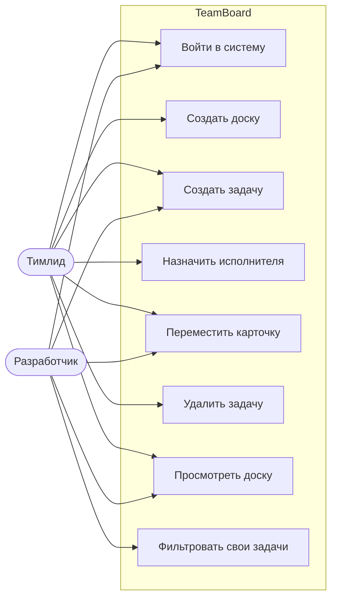
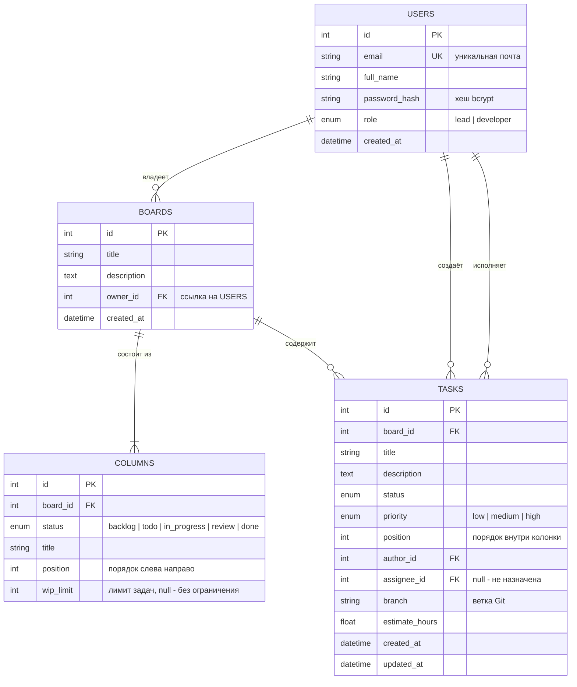
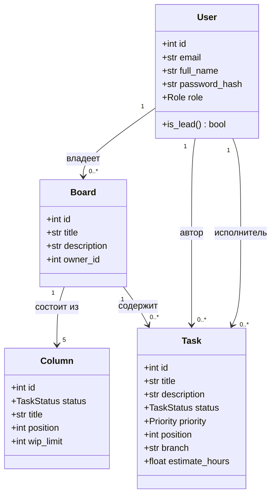
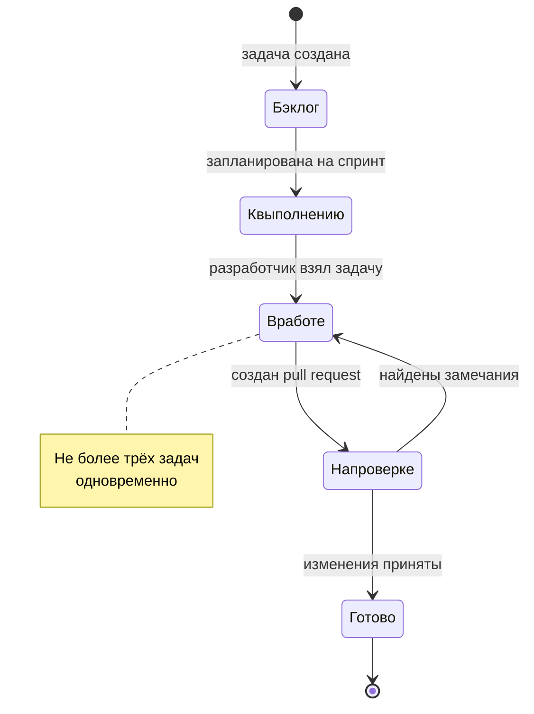
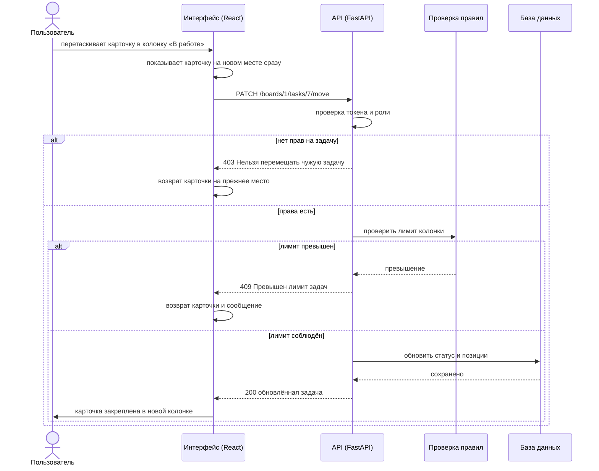

# Анализ предметной области

## Постановка задачи

Студенческая команда из двух человек ведёт учебный проект. Задачи ставятся устно
и теряются, непонятно, кто чем занят и что уже готово. Нужен модуль, который
показывает все задачи команды на одной доске и отражает их текущее состояние.

## Участники и их потребности

| Роль | Потребность |
|---|---|
| Тимлид | Разбить работу на задачи, назначить исполнителей, видеть общую картину, не допускать распыления команды |
| Разработчик | Видеть свои задачи, брать их в работу и отмечать выполнение |

## Основные понятия

| Понятие | Описание |
|---|---|
| Доска | Рабочее пространство команды, объединяющее задачи одного проекта |
| Колонка | Этап жизненного цикла задачи: бэклог, к выполнению, в работе, на проверке, готово |
| Задача | Единица работы с названием, описанием, приоритетом, исполнителем и веткой Git |
| Пользователь | Участник команды с ролью тимлида или разработчика |

## Правила предметной области

1. Создавать доски и удалять задачи может только тимлид.
2. Назначать задачу другому участнику может только тимлид; разработчик ставит задачи себе.
3. Перемещать карточку может тимлид или тот, на кого задача назначена.
4. В колонке «В работе» одновременно не может находиться больше трёх задач.
   Ограничение не даёт команде начинать всё сразу и бросать на половине.
5. Задача движется по колонкам слева направо, но возврат назад разрешён:
   например, с проверки обратно в работу, если найдены замечания.

## Диаграмма вариантов использования

## ER-диаграмма (модель данных)

### Пояснения к связям

| Связь | Тип | Смысл |
|---|---|---|
| USERS - BOARDS | один ко многим | тимлид владеет досками, которые создал |
| USERS - TASKS (автор) | один ко многим | каждая задача создана конкретным участником |
| USERS - TASKS (исполнитель) | один ко многим | участник может быть исполнителем нескольких задач |
| BOARDS - COLUMNS | один ко многим | доска состоит ровно из пяти колонок |
| BOARDS - TASKS | один ко многим | задача принадлежит одной доске |

Две связи между USERS и TASKS различаются внешними ключами `author_id`
и `assignee_id`: автор задачи и её исполнитель могут быть разными людьми.

## Нефункциональные требования

| Категория | Требование | Как обеспечено |
|---|---|---|
| Производительность | Доска со 100 задачами открывается не дольше 1 секунды | Одним запросом возвращаются и колонки, и задачи, сортировка выполняется в базе |
| Отзывчивость | Перетаскивание карточки отображается мгновенно | Интерфейс сразу показывает новое положение, запрос уходит фоном; при ошибке карточка возвращается назад |
| Безопасность: пароли | Пароли не хранятся в открытом виде | Хеширование bcrypt со случайной солью |
| Безопасность: доступ | Запрос без действительного токена отклоняется | Проверка JWT на каждом защищённом эндпоинте |
| Безопасность: права | Разработчик не выполняет действия тимлида | Проверка роли на стороне сервера, не только в интерфейсе |
| Надёжность данных | Некорректные данные не попадают в базу | Проверка схемами Pydantic до бизнес-логики |
| Переносимость | Смена СУБД без правки кода | Работа через SQLAlchemy, адрес базы вынесен в настройки |
| Сопровождаемость | Единый стиль кода в команде | Ruff и Prettier, проверка в CI и перед коммитом |
| Тестируемость | Ключевая логика покрыта тестами | 37 автотестов, покрытие серверной части 97 % |
| Совместимость | Работа в современных браузерах | Сборка Vite под стандарт ES2020 |

### Ограничения

1. Команда небольшая (2-5 человек), одновременная работа с одной доской.
2. Одновременно в колонке «В работе» не более трёх задач.
3. Приложение разворачивается локально, публичный адрес не требуется.
4. Поддержка только современных браузеров, Internet Explorer не учитывается.

## Диаграмма классов предметной области

## Диаграмма состояний задачи

## Диаграмма последовательности: перенос карточки

