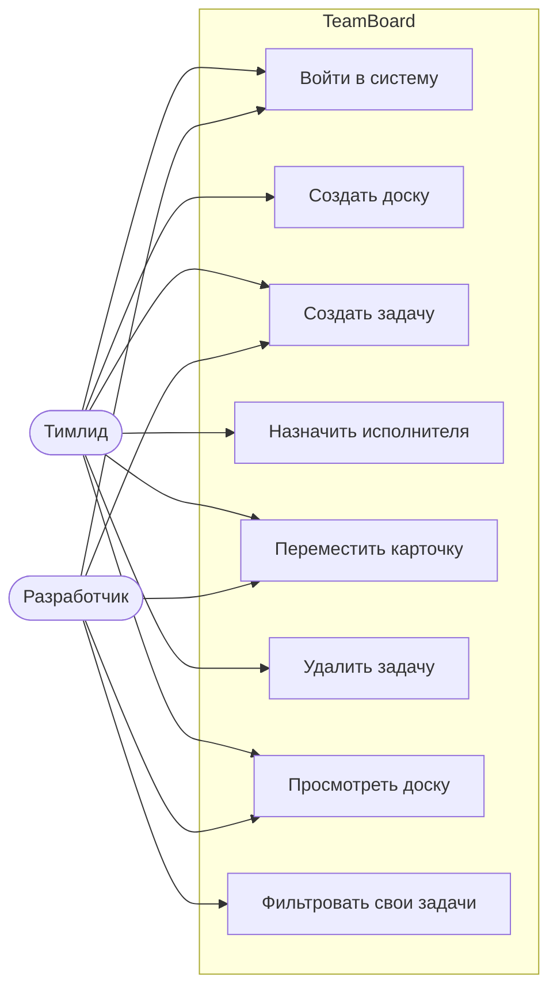
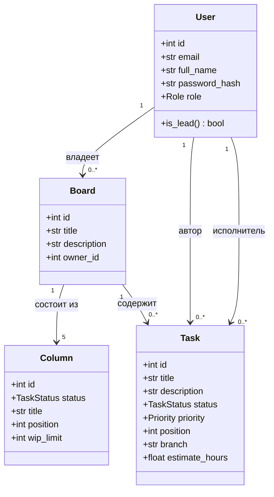
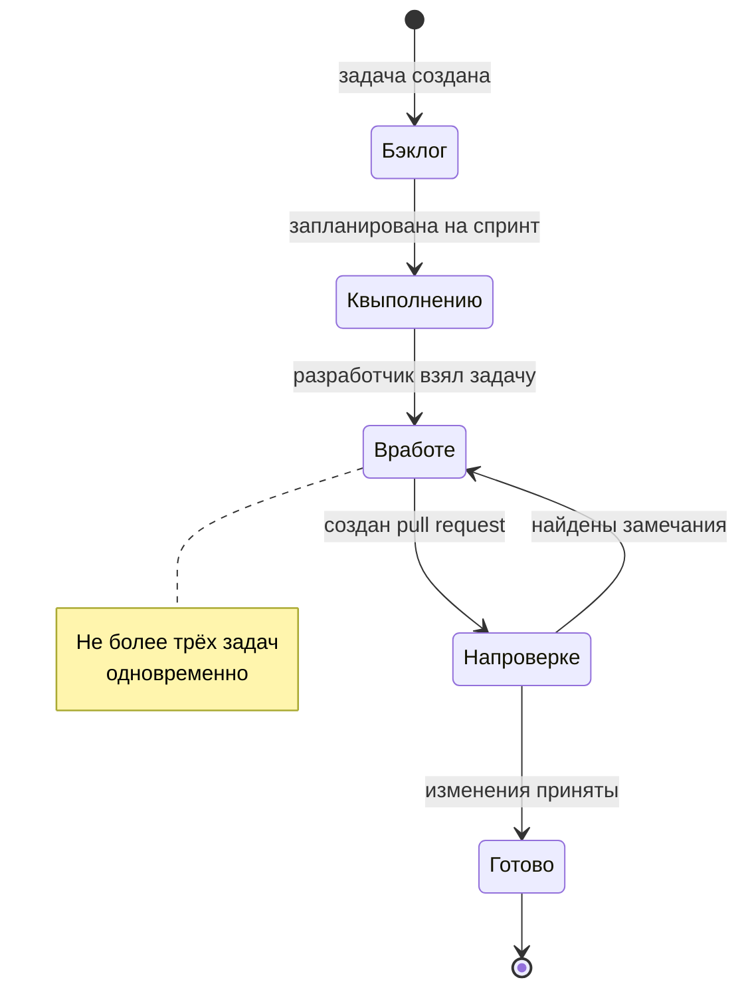
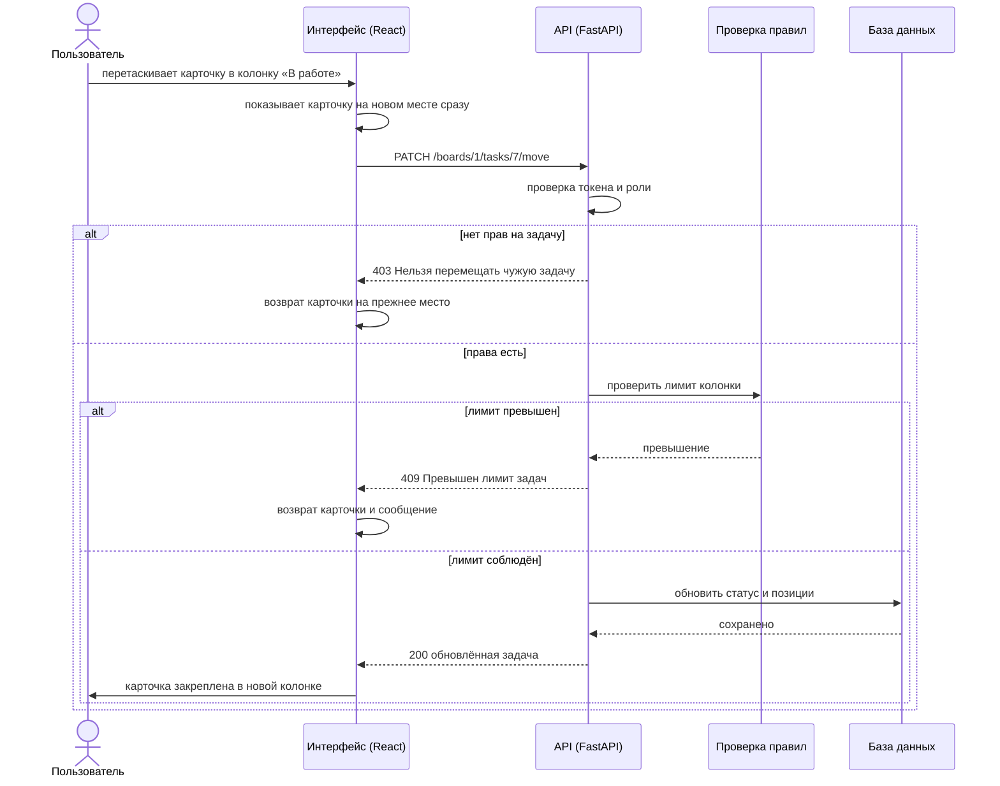

# Анализ предметной области

## Постановка задачи

Студенческая команда из двух человек ведёт учебный проект. Задачи ставятся устно
и теряются, непонятно, кто чем занят и что уже готово. Нужен модуль, который
показывает все задачи команды на одной доске и отражает их текущее состояние.

## Участники и их потребности

| Роль | Потребность |
|---|---|
| Тимлид | Разбить работу на задачи, назначить исполнителей, видеть общую картину, не допускать распыления команды |
| Разработчик | Видеть свои задачи, брать их в работу и отмечать выполнение |

## Основные понятия

| Понятие | Описание |
|---|---|
| Доска | Рабочее пространство команды, объединяющее задачи одного проекта |
| Колонка | Этап жизненного цикла задачи: бэклог, к выполнению, в работе, на проверке, готово |
| Задача | Единица работы с названием, описанием, приоритетом, исполнителем и веткой Git |
| Пользователь | Участник команды с ролью тимлида или разработчика |

## Правила предметной области

1. Создавать доски и удалять задачи может только тимлид.
2. Назначать задачу другому участнику может только тимлид; разработчик ставит задачи себе.
3. Перемещать карточку может тимлид или тот, на кого задача назначена.
4. В колонке «В работе» одновременно не может находиться больше трёх задач.
   Ограничение не даёт команде начинать всё сразу и бросать на половине.
5. Задача движется по колонкам слева направо, но возврат назад разрешён:
   например, с проверки обратно в работу, если найдены замечания.

## Диаграмма вариантов использования

## Диаграмма классов предметной области

## Диаграмма состояний задачи

## Диаграмма последовательности: перенос карточки

